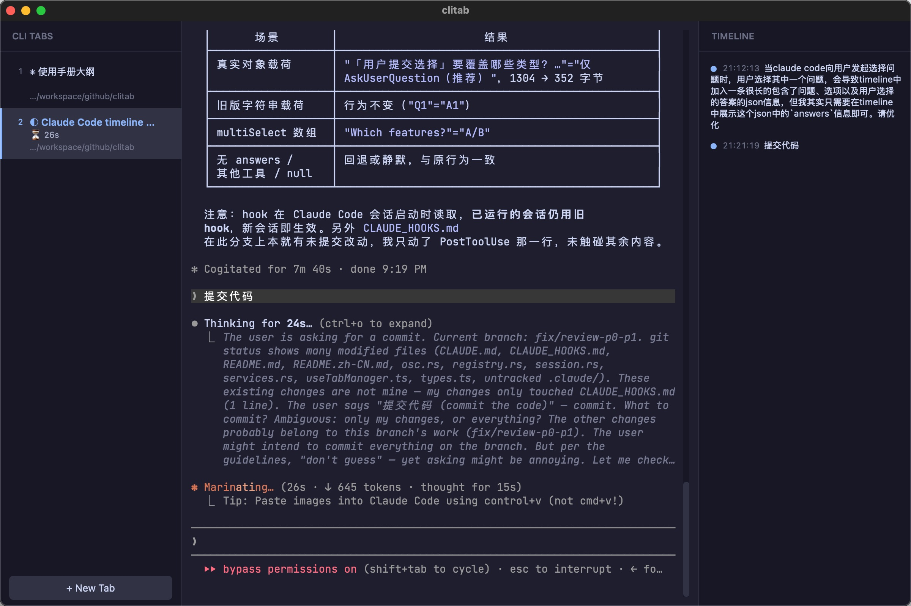

# clitab

[中文 README](README.zh-CN.md) · 📖 [User Manual (Wiki)](https://github.com/dongritengfei/clitab/wiki)

A tabbed terminal built for agent CLI sessions (Claude Code, Qoder CLI):
every tab is a real PTY running your shell, named after its working directory
— or after the session, once the agent gives it a title. Tabs flash when a
session needs your attention, so a row of parallel agents stays glanceable.



Built with [Tauri 2](https://tauri.app) (Rust + portable-pty) and
[xterm.js](https://xtermjs.org).

## Features

- **Real PTY tabs** named after their working directory — or after the agent
  session (Claude Code, Qoder CLI) running in them. `⌘T` new tab, `⌘W` close,
  drag to reorder.
- **Live agent status in the tab list** — see at a glance which session is
  working: each tab carries a live turn timer while its agent runs.
- **Jump to what needs you** — `⌘J` (next tab waiting for input); flashing
  tabs, a Dock badge and macOS notifications point the way.
- **Fast switching** — `⌃Tab` cycles, `⌘1–9` go straight to a tab.
- **Tab dashboard** — live tool timer, last turn's duration and waiting
  notices, via the optional agent hooks.
- **Session timeline** — a clickable log of every prompt you submitted and
  every answer you picked; clicking an entry scrolls the terminal back to
  that point. It even spans agent sessions within a tab.
- **Open from Finder** — Services → "New clitab Tab Here".
- **Resizable layout and font zoom** — drag the dividers between the three
  columns (double-click to reset); `⌘=` / `⌘-` / `⌘0` zoom the terminal text.
- **Terminal search** `⌘F`, desktop-grade shortcuts, 5000-line scrollback.

## Install (macOS)

Download the `.dmg` for your chip from [Releases](../../releases) —
`aarch64` for Apple Silicon (M1–M4), `x64` for Intel — and drag **clitab**
into Applications. Release builds are ad-hoc signed but **not notarized**, so
a fresh download trips macOS Gatekeeper twice;
[Getting Started](https://github.com/dongritengfei/clitab/wiki/Getting-Started)
walks through both one-time **Open Anyway** clicks.

## Agent integration

Run `claude` or `qodercli` in any tab like you would in a normal terminal —
clitab picks up the session title and flashes for attention with zero config.
The dashboard, timeline, notifications and waiting queue are powered by agent
hooks:
[Agent Setup](https://github.com/dongritengfei/clitab/wiki/Agent-Setup)
carries a copy-paste setup prompt for each agent (Claude Code and Qoder CLI).
[AGENT_HOOKS.md](AGENT_HOOKS.md) is the developer-facing protocol reference.

## Documentation

[Getting Started](https://github.com/dongritengfei/clitab/wiki/Getting-Started) ·
[Everyday Use](https://github.com/dongritengfei/clitab/wiki/Everyday-Use) ·
[Agent Setup](https://github.com/dongritengfei/clitab/wiki/Agent-Setup) ·
[Agent Features](https://github.com/dongritengfei/clitab/wiki/Agent-Features) ·
[Shortcuts](https://github.com/dongritengfei/clitab/wiki/Shortcuts) ·
[Troubleshooting](https://github.com/dongritengfei/clitab/wiki/Troubleshooting)

## Development

```bash
npm install
npm run tauri dev     # vite + tauri dev build
npm run dev:log       # the same, tee'd to /tmp/clitab-dev.log for reporting
npm run tauri build   # release bundle
```

Checks and tests:

```bash
npm run typecheck   # tsc --noEmit
npm run build       # typecheck + vite build
npm test            # cargo test --lib: OSC parser, registry, shell
                    # integration, replay ring, menu ids
```

## License

MIT — see [LICENSE](LICENSE).
